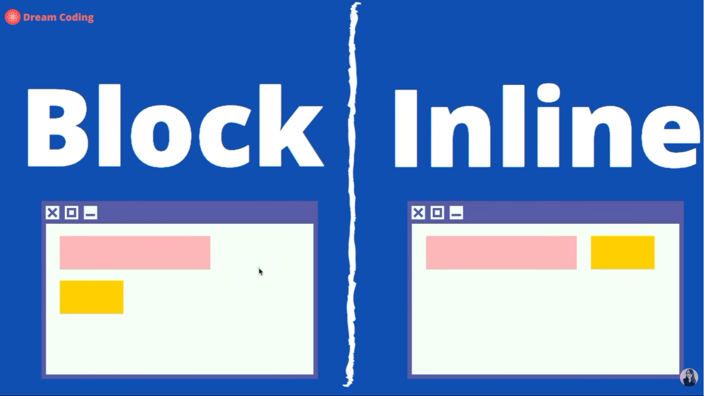
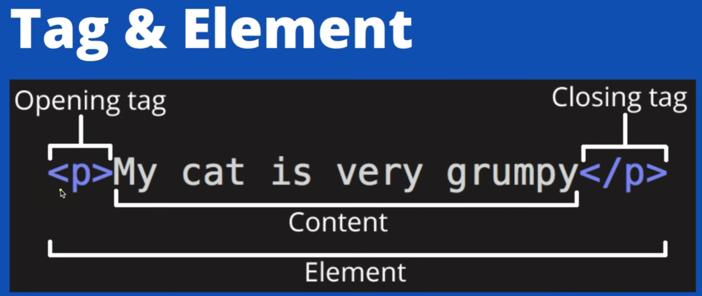
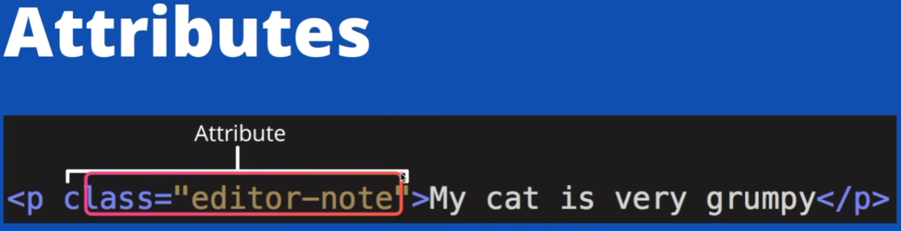

## Tag 의 큰 구분
### BOX : ITEM Tag 을 정리하고 Sectioning 하는 Tag (기본적으로 사용자에게 보여지지 않는 Tag)
- header
- nav
- main
- section
- article
- aside
- footer
- div
- span
- form

### ITEM : 사용자에게 보여지는 Tag
- a
- button
- label
- input
- img
- video
- audio
- map
- canvas
- table

## ITEM tag 구분

### Block : 대표적인 Tag 

**한줄에 하나의 tag만 존재함으로 추가된 Tag는 아래로 배치됨**

### Inline : 대표적인 Tag , <label>, <input>
**하나의 Tag 옆에 배치가 가능하나**

## Tag 와 Element

## Tag 의 Attribute
