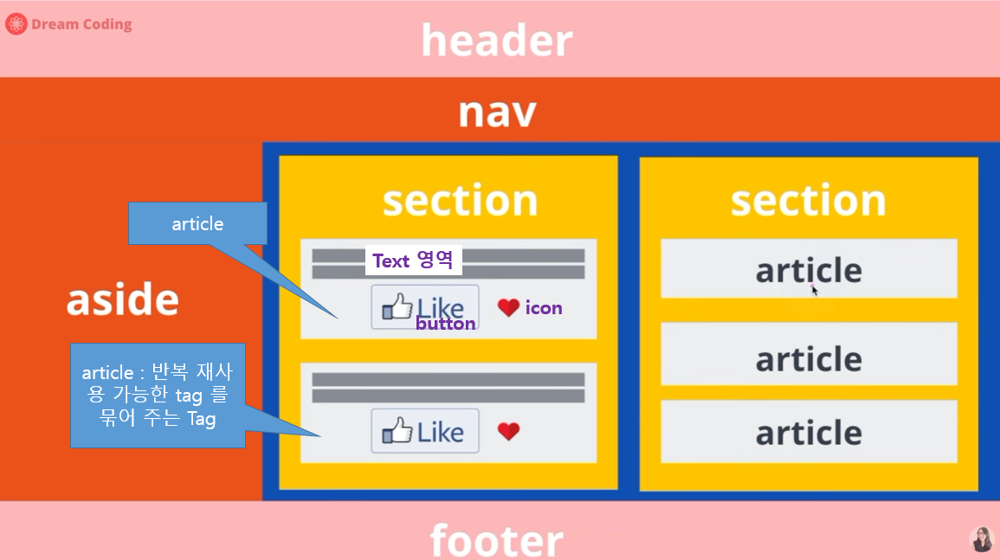
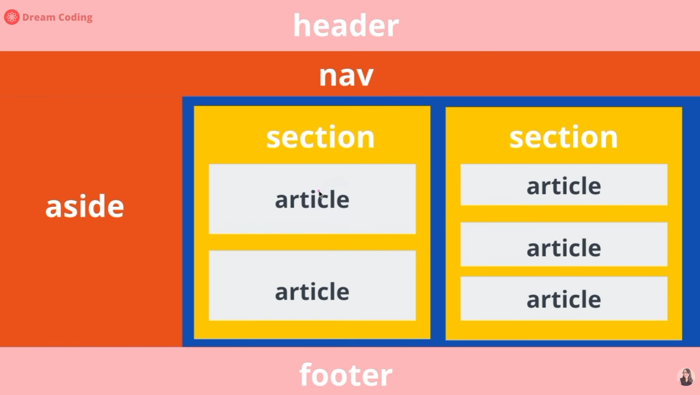

HTML에서 `<article>`과 `<section>`은 모두 콘텐츠를 의미 있게 구분하는 **시맨틱(Semantic) 태그**입니다. 하지만 사용 목적이 다릅니다.

핵심은 **`<article>`은 독립적으로 배포하거나 재사용할 수 있는 콘텐츠**, `<section>`은 **하나의 주제와 관련된 콘텐츠를 묶는 영역**이라는 점입니다.

## 1. `<article>`과 `<section>`의 차이

| 구분       | `<article>`                | `<section>`           |
| -------- | -------------------------- | --------------------- |
| 목적       | 독립적으로 완결된 콘텐츠              | 주제별 콘텐츠 영역            |
| 사용 예     | 게시글, 뉴스 기사, 블로그 글, 댓글      | 소개, 기능 설명, 프로젝트 목록 영역 |
| 독립성      | 다른 페이지나 서비스에서도 독립적으로 사용 가능 | 일반적으로 상위 콘텐츠의 일부      |
| 제목       | 제목을 사용하는 것이 일반적            | 제목을 사용하는 것이 일반적       |
| 상위·하위 관계 | 서로 고정된 상하 관계가 없음           | 서로 고정된 상하 관계가 없음      |

**중요:** `<article>`이 `<section>`보다 상위 태그이거나 그 반대인 것은 아닙니다. 콘텐츠의 의미에 따라 서로를 포함할 수 있습니다.

## 2. 서로의 상위·하위 관계

HTML에서는 다음 세 가지 구조가 모두 가능합니다.

### ① `<article>` 안에 `<section>`이 있는 경우

하나의 게시글을 여러 주제로 나누는 구조입니다.

```html
<article>
    <h1>Spring Boot 보안 아키텍처</h1>

    <section>
        <h2>OAuth 2.0</h2>
        <p>OAuth 2.0의 인증 및 인가 구조를 설명합니다.</p>
    </section>

    <section>
        <h2>JWT</h2>
        <p>JWT를 이용한 토큰 기반 인증을 설명합니다.</p>
    </section>
</article>
```

구조를 표현하면 다음과 같습니다.

```text
article: Spring Boot 보안 아키텍처
 ├── section: OAuth 2.0
 └── section: JWT
```

**하나의 독립적인 게시글(`<article>`) 안에서 주제별 영역(`<section>`)을 구분**한 것입니다.

### ② `<section>` 안에 `<article>`이 있는 경우

특정 주제에 해당하는 독립적인 게시글 여러 개를 표시하는 구조입니다.

```html
<section>
    <h2>최신 기술 뉴스</h2>

    <article>
        <h3>Spring Boot 4 출시</h3>
        <p>Spring Boot 4의 주요 변경 사항입니다.</p>
    </article>

    <article>
        <h3>React 최신 기능</h3>
        <p>React의 주요 기능과 변경 사항입니다.</p>
    </article>
</section>
```

구조는 다음과 같습니다.

```text
section: 최신 기술 뉴스
 ├── article: Spring Boot 4 출시
 └── article: React 최신 기능
```

**하나의 주제 영역(`<section>`) 안에 독립적인 게시글(`<article>`) 여러 개를 배치**한 것입니다.

### ③ `<article>`과 `<section>`을 각각 독립적으로 사용하는 경우

모든 콘텐츠에 두 태그를 함께 사용할 필요는 없습니다.

```html
<article>
    <h1>오늘의 개발 일지</h1>
    <p>오늘은 Spring Security를 학습했습니다.</p>
</article>
```

위 콘텐츠는 독립적인 게시글이므로 `<article>`만 사용해도 됩니다.

반면, 페이지에서 특정 주제를 구분하는 경우에는 `<section>`을 사용할 수 있습니다.

```html
<section>
    <h2>서비스 소개</h2>
    <p>우리 서비스는 개발 프로젝트를 관리합니다.</p>
</section>
```

---

## 3. 실무에서 언제 사용하는가?

React 기반 웹 애플리케이션을 개발한다면 다음 기준으로 판단하면 됩니다.

| 화면 구성 요소         | 권장 태그                             | 이유                   |
| ---------------- | --------------------------------- | -------------------- |
| 블로그 게시글 상세       | `<article>`                       | 독립적인 콘텐츠             |
| 뉴스 목록의 개별 뉴스     | `<article>`                       | 개별 뉴스가 독립적인 콘텐츠      |
| 게시글 목록 전체        | `<section>` 또는 `<main>` 내부의 목록 구조 | 게시글을 묶는 영역           |
| 서비스 소개 영역        | `<section>`                       | 주제별 콘텐츠 영역           |
| 프로젝트 상세 정보       | 상황에 따라 `<article>` 또는 `<section>` | 독립성에 따라 결정           |
| 대시보드의 프로젝트 목록 영역 | `<section>`                       | 프로젝트 목록이라는 주제 영역     |
| 독립적인 프로젝트 설명 카드  | 상황에 따라 `<article>`                | 카드 자체가 독립적인 콘텐츠인지 판단 |
| 페이지의 주요 콘텐츠      | `<main>`                          | 페이지의 핵심 콘텐츠 영역       |
| 페이지 상단 헤더        | `<header>`                        | 소개 및 헤더 영역           |
| 페이지 하단           | `<footer>`                        | 푸터 영역                |

### React 컴포넌트 예시

프로젝트 관리 페이지를 만든다고 가정하겠습니다.

```tsx
export function MyProjectsPage() {
    return (
        <main>
            <section aria-labelledby="projects-title">
                <h1 id="projects-title">내 프로젝트</h1>

                <article>
                    <h2>반도체 분석 시스템</h2>
                    <p>반도체 공정 데이터를 분석하는 프로젝트입니다.</p>
                </article>

                <article>
                    <h2>프로젝트 관리 시스템</h2>
                    <p>개발 프로젝트의 진행 상황을 관리합니다.</p>
                </article>
            </section>
        </main>
    );
}
```

이 구조에서는 다음과 같이 해석할 수 있습니다.

* `<main>`: 페이지의 주요 콘텐츠
* `<section>`: 내 프로젝트라는 주제 영역
* `<article>`: 개별 프로젝트를 독립적인 콘텐츠로 표현

단, 프로젝트 카드가 독립적인 콘텐츠가 아니라 단순히 목록의 한 항목이라면 `<article>` 대신 `<div>`나 `<li>`를 사용하는 것이 더 적절할 수도 있습니다.

---

## 4. `<section>` 대신 `<div>`를 사용해야 하는 경우

`<section>`은 단순히 영역을 나누기 위해 사용하는 태그가 아닙니다.

**콘텐츠의 주제적 구분이 필요한 경우에는 `<section>`, 스타일링이나 레이아웃을 위한 그룹화라면 `<div>`**를 사용하는 것이 기본 원칙입니다.

예를 들어 Tailwind CSS로 카드 레이아웃을 구성한다면 다음과 같습니다.

```tsx
<div className="grid grid-cols-3 gap-4">
    <div className="rounded-lg border p-4">
        프로젝트 A
    </div>

    <div className="rounded-lg border p-4">
        프로젝트 B
    </div>

    <div className="rounded-lg border p-4">
        프로젝트 C
    </div>
</div>
```

이 코드의 목적은 단순히 3개의 카드를 배치하는 것이므로 `<div>`를 사용해도 충분합니다.

반면, 프로젝트 목록이라는 의미 있는 영역을 표현하려면 다음과 같이 구성할 수 있습니다.

```tsx
<section aria-labelledby="project-list-title">
    <h2 id="project-list-title">프로젝트 목록</h2>

    <ul className="grid grid-cols-3 gap-4">
        <li className="rounded-lg border p-4">
            프로젝트 A
        </li>

        <li className="rounded-lg border p-4">
            프로젝트 B
        </li>

        <li className="rounded-lg border p-4">
            프로젝트 C
        </li>
    </ul>
</section>
```

[ 참고 : aria-labelledby ]
`aria-labelledby`는 접근성(ARIA) 속성으로, **현재 요소의 이름(라벨)을 다른 요소의 텍스트로 지정**합니다.

예를 들어:

```html
<h2 id="project-list-title">프로젝트 목록</h2>

<section aria-labelledby="project-list-title">
  ...
</section>
```

이때 `section`의 접근성 이름은 “프로젝트 목록”이 됩니다. 스크린 리더가 해당 영역으로 이동했을 때 어떤 내용의 영역인지 알려주는 데 도움이 됩니다.

`aria-labelledby` 값은 연결할 요소의 `id`와 일치해야 합니다. `id`가 없거나 맞지 않으면 라벨이 제대로 전달되지 않습니다. `section`에 제목이 없다면, 제목을 추가해 연결하거나 의미에 맞게 다른 라벨링 방법을 사용할 수 있습니다.


여기서는 주제 영역에 `<section>`, 목록에 `<ul>`, 개별 항목에 `<li>`를 사용했습니다.

---

## 5. 핵심 정리

다음 세 가지 질문으로 태그를 선택하면 됩니다.

1. **독립적으로 배포하거나 재사용할 수 있는 완결된 콘텐츠인가?** → `<article>`

2. **특정 주제에 해당하는 콘텐츠 영역인가?** → `<section>`

3. **단순한 스타일링이나 레이아웃 목적의 그룹인가?** → `<div>`

그리고 `<article>`과 `<section>` 사이에 정해진 상위·하위 관계는 없습니다. 콘텐츠 구조에 따라 서로를 포함할 수 있습니다.

실무에서는 모든 영역에 시맨틱 태그를 억지로 적용하기보다, **콘텐츠의 의미가 명확한 곳에만 `<article>`, `<section>`, `<main>` 등을 사용하고 나머지는 `<div>`로 구성하는 방식**이 좋습니다.


