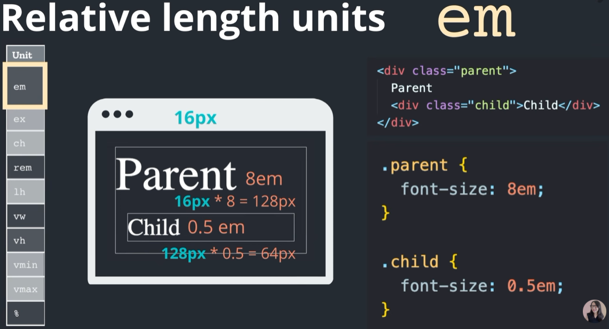
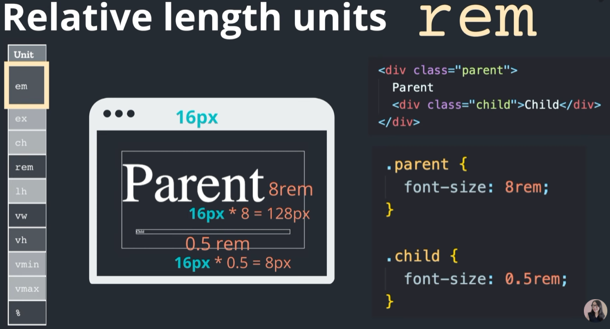
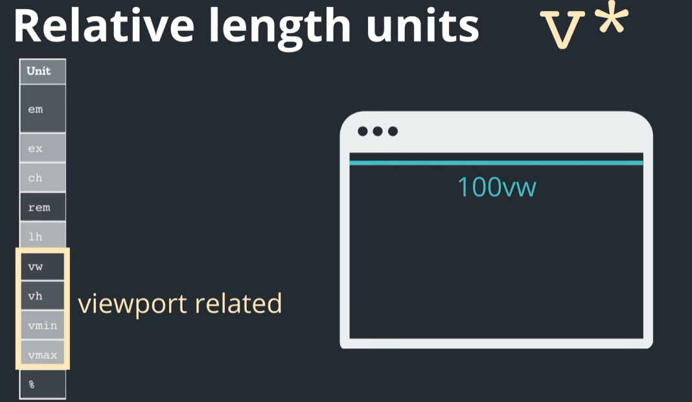
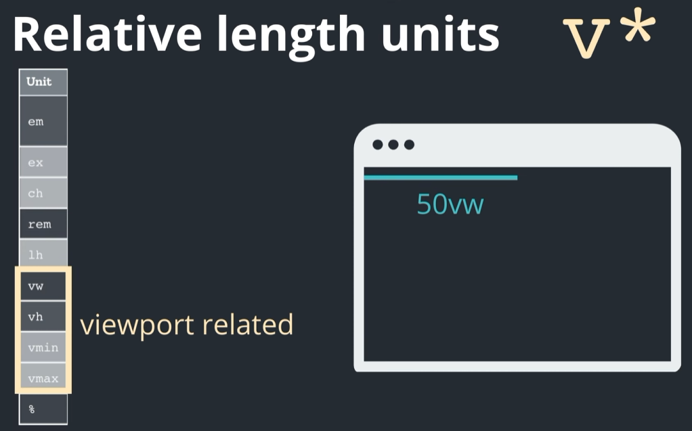
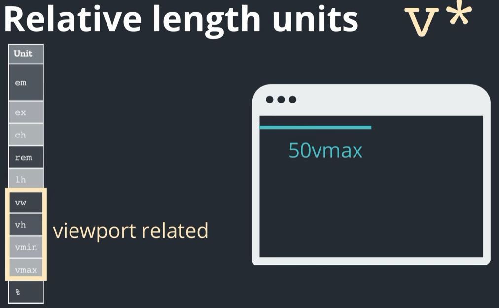
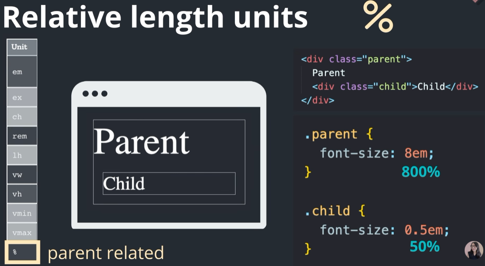
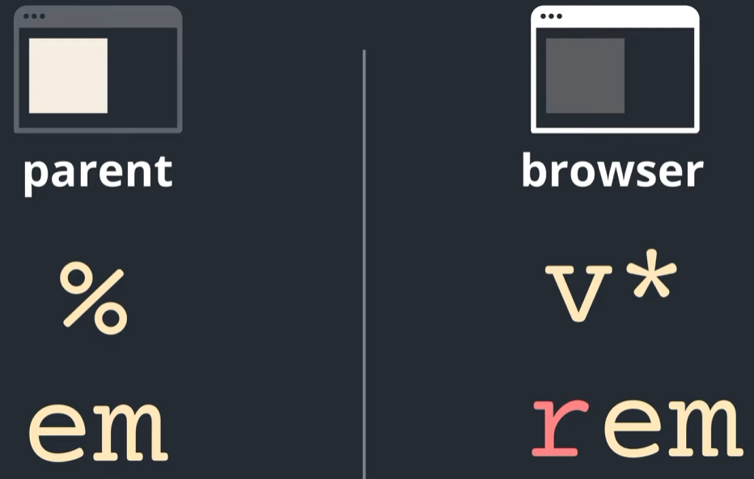
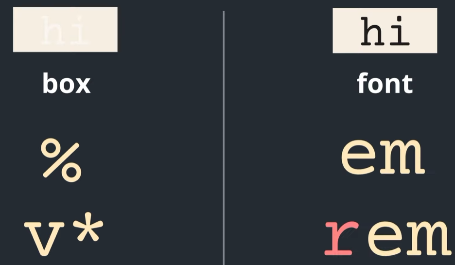
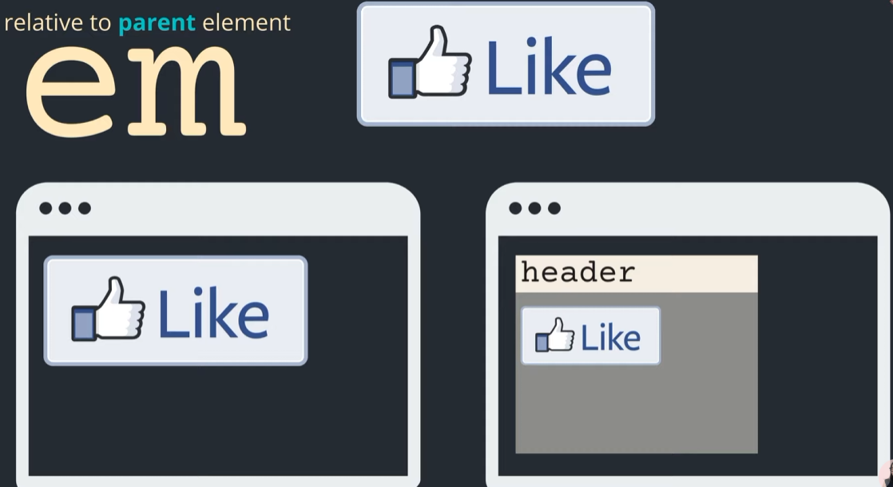

# 1. Absolute unit : px

# 2. Relative Units

## 1). em : 부모 element 크기의 비례 크기 지정



## 2). rem : 브라우저 html 기본 element 크기 비례 크기 지정



### 중요 : css html root 의 font size 가변적으로 설정해야 브라우저 % 변경에 따라 글자크가가 자동으로 변함

```html

<style>
  html {
    font-size: 100% <!-- 16px 100% 적용 -->
  }
</style>
```

### 중요 : css html root 의 font size 고정 px 설정하면 브라우저 % 변경에 따라 글자크가가 변하지 않음

## 3). 100vw : 브라우저 가로 view port(브라우저 가로) 100% 를 쓰겠다.  



## 4). 50vw : 브라우저 가로 view port(브라우저 가로) 50% 를 쓰겠다.  


## 5). vmin : 브라우저 브라우저 가로 세로 중 작은 것의 50% 를 쓰겠다.



## 6). vmax : 브라우저 브라우저 가로 세로 중 큰 것의 50% 를 쓰겠다.



## 7). % : 부모 요소의 크기의 비례 % 크기롤 지정



# 3. relative length units 사용기준

**부모 요소 크기에 따라 가변적이어야 하면 : `%, em`**
**브라우저 요소 크기에 따라 가변적이어야 하면 : `v*, rem`** 




**요소의 높이와 넓이에 따라 가변적이어야 하면 (box): `%, v`***
**font 사이즈에 따라 가변적이어야 하면 (font): `em, rem`**



**rem : relative ro root element**
**➡️ font size 결정 할때 rem 을 사용하는게 유리함**


**em :  relative ro parent element**


