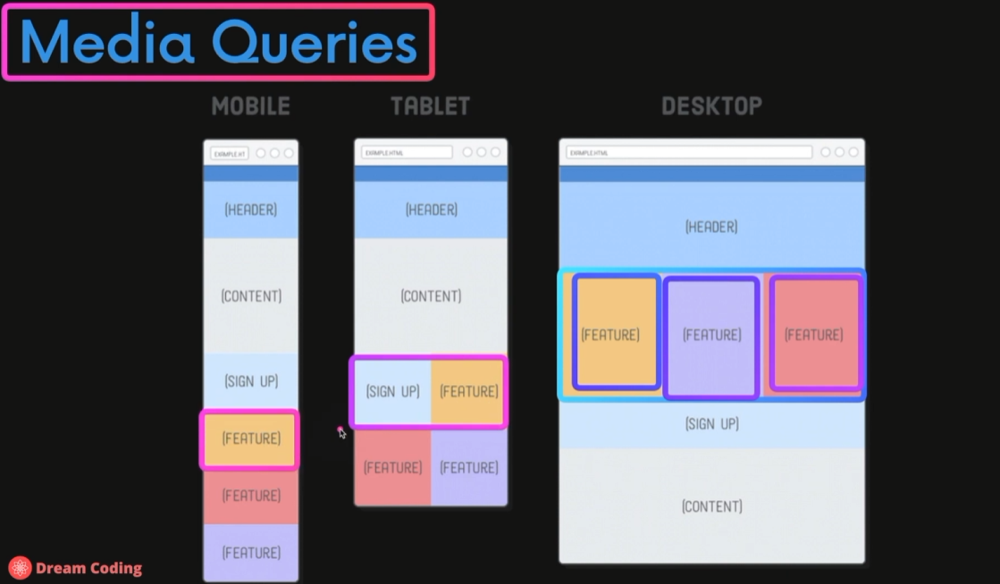
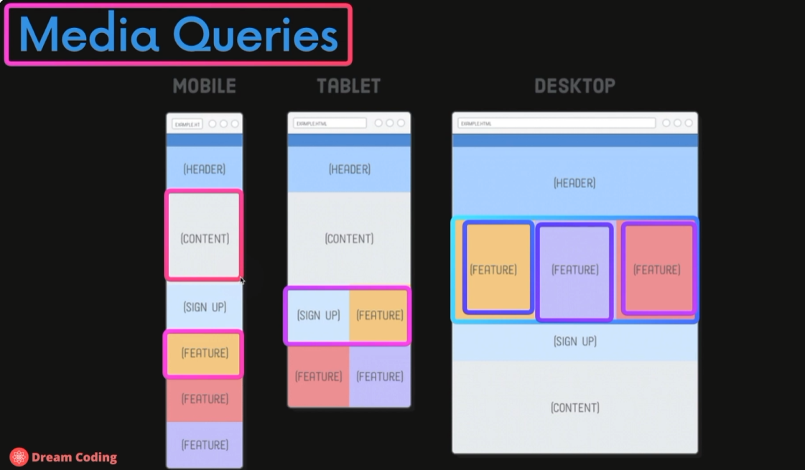
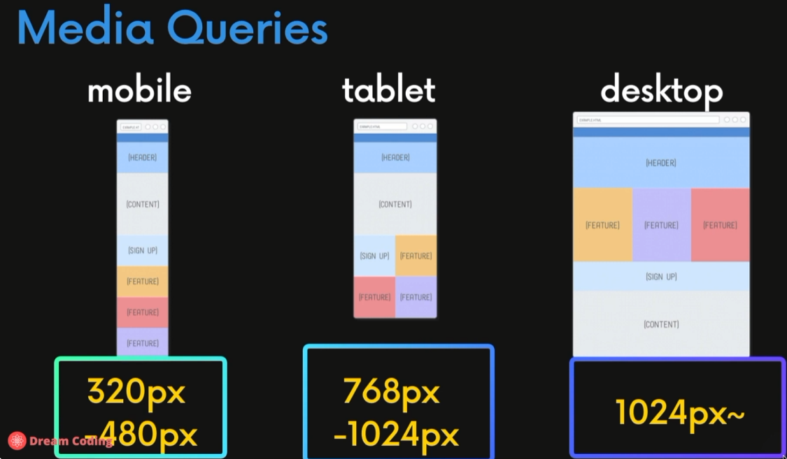
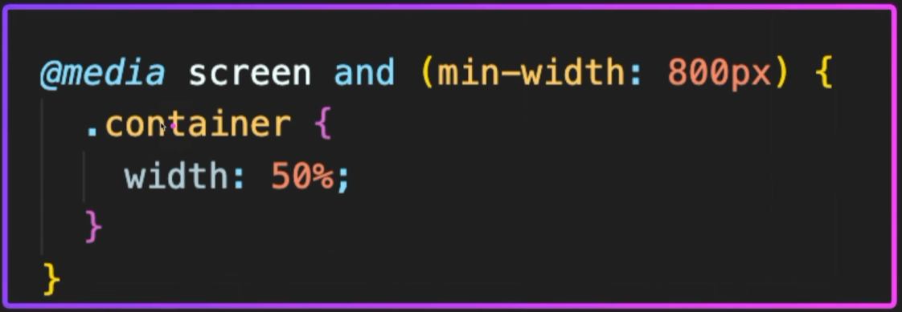
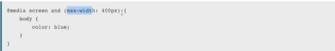

### 1. 각 Device 별로 Content 위치 재배치

**모바일에서 특정 콘텐츠를 위로 배치하여 강조하기**

### 2. 각 device 별 breakpoint 참고

### 3. 이것을 가능하게 하는 문법 ➡️ media query

**참고 1: https://developer.mozilla.org/ko/docs/Learn_web_development/Core/CSS_layout/Responsive_Design**

**참고 2: https://developer.mozilla.org/ko/docs/Learn_web_development/Core/CSS_layout/Media_queries**

**브라우저 가로 폭이 800px 이상이면 container 클래스를 브라우저 폭의 50% 로 지정**

**브라우저 가로 폭이 0 ~ 400px 사이면 전체 color 를 blue 로 유지**

